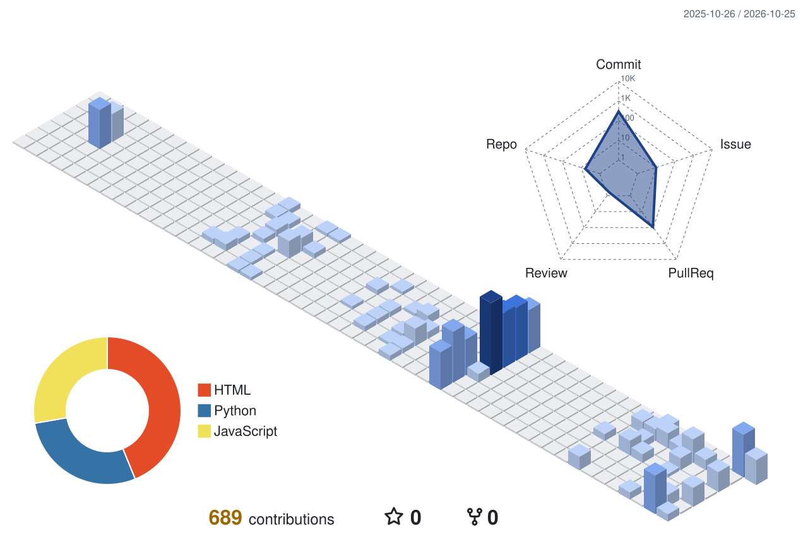

<!--
  profile readme for github.com/zuromu

  everything in dist/ gets redrawn every night by .github/workflows/profile.yml
  (the neofetch card, the dribbling ball and the 3D city).
  to change what the card says, edit the lists at the top of scripts/neofetch.py.
  to add a project, copy one of the project paragraphs below.
  the devlog list fills itself in from scripts/devlog.py, so don't edit between its markers.
-->

  <picture>
    <source media="(prefers-color-scheme: dark)" srcset="dist/neofetch-dark.svg">
    <source media="(prefers-color-scheme: light)" srcset="dist/neofetch-light.svg">
    
  </picture>

## hi, I'm Ahmad

CS student at Universitas Indonesia (international program), from Jakarta. This is where my uni projects and side stuff end up.

## projects

**[swish-rl](https://github.com/zuromu/swish-rl)** is a 2D basketball game where an AI is supposed to learn how to shoot using reinforcement learning. Still very early, right now it's a ball that falls and bounces.

**[Cesium Guard](https://github.com/zuromu/cesium-guard-mvp)** is what my team made for the RISTEK Mini Hackathon 2025. It's a dashboard for tracking radioactive contamination in shrimp exports, built with React and Flask.

**[Wanderer's Koperasi Quest](https://github.com/zuromu/Wanderers-Koperasi)** is a small browser RPG about how koperasi (cooperatives) work. Made with friends in Phaser, and you can [play it in your browser](https://wanderers-koperasi.vercel.app/).

## devlog

Notes I write after finishing each milestone.

<!-- devlog:start -->
- [M1: Physics sandbox](https://github.com/zuromu/swish-rl/blob/main/docs/devlog/m1-physics-sandbox.md) in swish-rl, Oct 25, 2026
<!-- devlog:end -->

## stack

## activity

<picture>
  <source media="(prefers-color-scheme: dark)" srcset="dist/dribble-dark.svg">
  <source media="(prefers-color-scheme: light)" srcset="dist/dribble-light.svg">
  
</picture>

same thing as a 3D city

 
<picture>
  <source media="(prefers-color-scheme: dark)" srcset="dist/city-dark.svg">
  <source media="(prefers-color-scheme: light)" srcset="dist/city-light.svg">
  
</picture>

## take a free throw

Pick a power and GitHub opens an issue for you. Hit **Create**, and about a minute later a workflow takes your shot with real physics and replies with how it went.

[<kbd> 1 </kbd>](https://github.com/zuromu/zuromu/issues/new?title=shoot+1&body=Hit+Create+below.+Your+shot+gets+taken+in+about+a+minute+and+the+result+shows+up+here.) [<kbd> 2 </kbd>](https://github.com/zuromu/zuromu/issues/new?title=shoot+2&body=Hit+Create+below.+Your+shot+gets+taken+in+about+a+minute+and+the+result+shows+up+here.) [<kbd> 3 </kbd>](https://github.com/zuromu/zuromu/issues/new?title=shoot+3&body=Hit+Create+below.+Your+shot+gets+taken+in+about+a+minute+and+the+result+shows+up+here.) [<kbd> 4 </kbd>](https://github.com/zuromu/zuromu/issues/new?title=shoot+4&body=Hit+Create+below.+Your+shot+gets+taken+in+about+a+minute+and+the+result+shows+up+here.) [<kbd> 5 </kbd>](https://github.com/zuromu/zuromu/issues/new?title=shoot+5&body=Hit+Create+below.+Your+shot+gets+taken+in+about+a+minute+and+the+result+shows+up+here.) [<kbd> 6 </kbd>](https://github.com/zuromu/zuromu/issues/new?title=shoot+6&body=Hit+Create+below.+Your+shot+gets+taken+in+about+a+minute+and+the+result+shows+up+here.) [<kbd> 7 </kbd>](https://github.com/zuromu/zuromu/issues/new?title=shoot+7&body=Hit+Create+below.+Your+shot+gets+taken+in+about+a+minute+and+the+result+shows+up+here.) [<kbd> 8 </kbd>](https://github.com/zuromu/zuromu/issues/new?title=shoot+8&body=Hit+Create+below.+Your+shot+gets+taken+in+about+a+minute+and+the+result+shows+up+here.) [<kbd> 9 </kbd>](https://github.com/zuromu/zuromu/issues/new?title=shoot+9&body=Hit+Create+below.+Your+shot+gets+taken+in+about+a+minute+and+the+result+shows+up+here.) [<kbd> 10 </kbd>](https://github.com/zuromu/zuromu/issues/new?title=shoot+10&body=Hit+Create+below.+Your+shot+gets+taken+in+about+a+minute+and+the+result+shows+up+here.)

<!-- freethrow:start -->
<picture>
  <source media="(prefers-color-scheme: dark)" srcset="dist/shot-1-dark.svg">
  <source media="(prefers-color-scheme: light)" srcset="dist/shot-1-light.svg">
  
</picture>

1 made out of 1 shot so far, 1 of them a swish.

| shooter | power | result |
|---|---|---|
| [zuromu](https://github.com/zuromu) | 7 | swish |
<!-- freethrow:end -->
